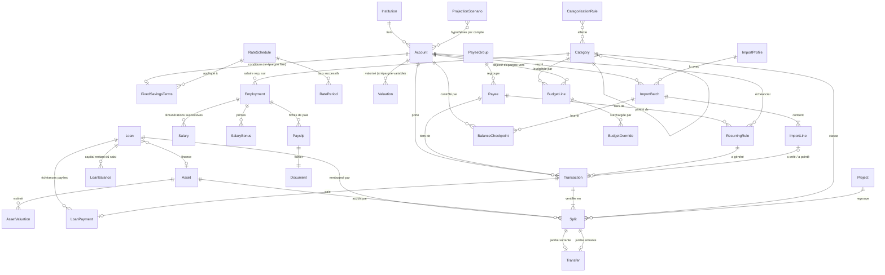

# Modèle de données

Statut : **Validée** (2026-10-20)

Modèle **logique**. Sa traduction physique (SQLite, cf. `architecture.md` § SQLite) suit ADR-0009. Ce document est la source de vérité du schéma.
Les règles métier détaillées sont dans les specs ; ici ne figurent que les contraintes structurelles.

## Types logiques

| Type | Représentation | Référence |
|---|---|---|
| `Id` | UUIDv7 (triable dans le temps, généré côté application) | ADR-0011 |
| `Money` | Entier signé 64 bits, en **unités mineures** de la devise (centimes pour l'euro, décimales selon ISO 4217). La devise est celle du compte. | ADR-0001 |
| `Quantity`, `UnitPrice` | Décimal exact à précision libre, stocké en texte. Réservé au futur suivi des titres (V2) ; jamais un `Money`. | ADR-0001 |
| `Rate` | Entier en **millionièmes** (ppm) : 1,7 % = `17000`, 0,85 % = `8500` | ADR-0001 |
| `Date` | Date calendaire ISO 8601 `YYYY-MM-DD`, sans heure ni fuseau | ADR-0012 |
| `Timestamp` | Instant UTC, réservé à l'audit (`created_at`, `updated_at`…) | ADR-0012 |
| `Currency` | Code ISO 4217 sur 3 lettres | — |
| `Json` | Document JSON validé par un schéma propre à chaque champ | — |

### Correspondance physique SQLite (ADR-0017)

Toutes les tables sont `STRICT`. Les types absents de SQLite sont remplacés par des contraintes `CHECK` :

| Type logique | Colonne SQLite | Contrainte |
|---|---|---|
| `Id` | `TEXT` | `CHECK (length(col) = 36)` — UUID en minuscules avec tirets |
| `Money` | `INTEGER` | — (unités mineures) |
| `Quantity`, `UnitPrice` | `TEXT` | décimal valide, analysé par le cœur (V2) |
| `Rate` | `INTEGER` | `CHECK (col >= 0)` si le taux ne peut pas être négatif |
| `Date` | `TEXT` | `CHECK (col = date(col))` — format `YYYY-MM-DD` valide |
| Mois `YYYY-MM` | `TEXT` | `CHECK (col GLOB '[0-9][0-9][0-9][0-9]-[0-1][0-9]')` et mois entre 01 et 12 |
| `Timestamp` | `TEXT` | ISO 8601 UTC, `CHECK (col LIKE '%Z')` |
| booléen | `INTEGER` | `CHECK (col IN (0, 1))` |
| enum | `TEXT` | `CHECK (col IN ('VALEUR_A', 'VALEUR_B', …))` |
| `Json` | `TEXT` | `CHECK (json_valid(col))` |

Les noms de tables sont au singulier et en `snake_case` (`account`, `transaction`, `split`…). Le mot
`transaction` étant réservé en SQL, la table est nommée `ledger_transaction`.

Toutes les entités portent `id: Id`, `created_at: Timestamp` et `updated_at: Timestamp`,
qui ne sont pas répétés ci-dessous.

## Vue d'ensemble

## Comptes — [spec 01](specs/01-comptes.md)

### Institution

| Champ | Type | Contraintes |
|---|---|---|
| `name` | texte ≤ 80 | requis, unique |
| `bank_code` | texte 5 | optionnel (code banque français) |
| `bic` | texte 8 ou 11 | optionnel |
| `archived` | booléen | défaut `false` |

### Account

| Champ | Type | Contraintes |
|---|---|---|
| `name` | texte ≤ 80 | requis |
| `kind` | `AccountKind` | requis, non modifiable si le compte a des transactions ou des valorisations |
| `institution_id` | `Id` → Institution | optionnel (ex. espèces) |
| `currency` | `Currency` | requis, défaut `EUR`, non modifiable |
| `opening_date` | `Date` | requis |
| `opening_balance` | `Money` | requis, défaut 0 |
| `iban` | texte ≤ 34 | optionnel, validé (clé de contrôle), affiché masqué |
| `account_number` | texte ≤ 30 | optionnel |
| `closed_on` | `Date` | optionnel, ≥ `opening_date` |
| `include_in_net_worth` | booléen | défaut `true` |
| `include_in_emergency_fund` | booléen | défaut `true` pour `CASH`, `LIVRET_A`, `LDDS`, `LEP`, `LIVRET_JEUNE` ; `false` sinon (R-CPT-13) |
| `include_in_budget` | booléen | défaut `true` pour `CASH`, `false` sinon ; toujours `false` pour `VARIABLE_SAVINGS` (R-BUD-1) |
| `display_order` | entier | ordre dans la famille ; à la création, après le dernier compte de la famille (CPT-07) |
| `color` | texte | optionnel, `#RRGGBB` (CPT-07) |
| `notes` | texte | optionnel |

`AccountKind` → `AccountFamily` (correspondance fixe, cf. spec 01) :

| Famille | Natures |
|---|---|
| `CASH` | `CHECKING`, `CASH_WALLET`, `OTHER_CASH` |
| `FIXED_SAVINGS` | `LIVRET_A`, `LDDS`, `LEP`, `LIVRET_JEUNE`, `CEL`, `PEL`, `TERM_DEPOSIT`, `SAVINGS_OTHER` |
| `VARIABLE_SAVINGS` | `LIFE_INSURANCE`, `PEA`, `PEA_PME`, `PER`, `SECURITIES`, `EMPLOYEE_SAVINGS`, `CRYPTO`, `VARIABLE_OTHER` |

### BankStatement (relevé de compte, CPT-11)

| Champ | Type | Contraintes |
|---|---|---|
| `account_id` | `Id` → Account | requis, suppression en cascade (le document est supprimé par le service) |
| `statement_month` | `Date` | requis, premier jour d'un mois |
| `period_start`, `period_end` | `Date` | optionnels, ensemble ; `period_start ≤ period_end` |
| `document_id` | `Id` → Document | requis, unique ; un PDF |
| `note` | texte | optionnel |

Plusieurs relevés par mois sont permis (R-CPT-18). Un même fichier (`Document.sha256`) ne s'archive qu'une
fois par compte (R-CPT-19). Le fichier est immuable : seuls `statement_month` et `note` se modifient
(R-CPT-20).

### FixedSavingsTerms (1–1 avec un compte `FIXED_SAVINGS`)

| Champ | Type | Contraintes |
|---|---|---|
| `account_id` | `Id` → Account | clé primaire |
| `rate_schedule_id` | `Id` → RateSchedule | requis |
| `interest_method` | `InterestMethod` | `FORTNIGHTLY` \| `DAILY` \| `MONTHLY` |
| `capitalization` | enum | `ANNUAL` (au 31/12) \| `MONTHLY` \| `AT_MATURITY` |
| `deposit_cap` | `Money` | optionnel |
| `maturity_date` | `Date` | optionnel (compte à terme, PEL) |
| `interest_category_id` | `Id` → Category | catégorie des transactions d'intérêts générées |
| `round_each_fortnight` | `bool` | défaut `false` : arrondir l'intérêt de chaque quinzaine plutôt que le total (R-EPA-6) |

### RateSchedule / RatePeriod

| RateSchedule | Type | Contraintes |
|---|---|---|
| `name` | texte | requis, unique (ex. « Livret A (réglementé) ») |
| `shared` | booléen | `true` si plusieurs comptes peuvent l'utiliser (taux réglementés) |

| RatePeriod | Type | Contraintes |
|---|---|---|
| `schedule_id` | `Id` → RateSchedule | requis |
| `effective_from` | `Date` | requis, unique par barème |
| `annual_rate` | `Rate` | requis, ≥ 0 |

Un taux s'applique de `effective_from` jusqu'au `effective_from` suivant (exclu).

### Valuation (comptes `VARIABLE_SAVINGS`)

| Champ | Type | Contraintes |
|---|---|---|
| `account_id` | `Id` → Account | requis |
| `date` | `Date` | requis, unique avec `account_id` |
| `value` | `Money` | requis |
| `source` | enum | `MANUAL` \| `IMPORT` |
| `note` | texte | optionnel |

## Transactions — [spec 02](specs/02-transactions.md)

### Category

| Champ | Type | Contraintes |
|---|---|---|
| `name` | texte ≤ 60 | requis, unique au sein d'un même parent |
| `kind` | `CategoryKind` | `INCOME` \| `EXPENSE`, identique à celui du parent |
| `parent_id` | `Id` → Category | optionnel, profondeur max 2 |
| `archived` | booléen | défaut `false` |
| `excluded_from_analyses` | booléen | défaut `false` : catégorie hors analyses (R-TRX-24) |
| `display_order` | entier | — |
| `color`, `icon` | texte | optionnels |

### Transaction

| Champ | Type | Contraintes |
|---|---|---|
| `account_id` | `Id` → Account | requis |
| `date` | `Date` | requis, ≥ `opening_date` du compte, ≤ `closed_on` s'il existe. Date choisie par l'utilisateur : affichage, budgets, rapports |
| `bank_date` | `Date` | optionnel : date de l'opération selon la banque, renseignée à l'import ou au pointage ; mêmes bornes que `date` |
| `balance_date` | `Date` | **colonne générée** = `COALESCE(bank_date, date)` : date utilisée pour les soldes et le rapprochement (R-TRX-7) |
| `value_date` | `Date` | optionnel : date de valeur bancaire (intérêts) |
| `amount` | `Money` | requis, ≠ 0 |
| `bank_label` | texte ≤ 500 | optionnel (absent pour une saisie manuelle), immuable une fois renseigné |
| `label` | texte ≤ 200 | requis (défaut : `bank_label`) |
| `note` | texte | optionnel |
| `clearing_status` | `ClearingStatus` | `PENDING` \| `CLEARED` \| `RECONCILED` |
| `origin` | `TransactionOrigin` | `MANUAL` \| `IMPORT` \| `RECURRING` \| `INTEREST` |
| `recurring_rule_id` | `Id` → RecurringRule | optionnel |
| `fingerprint` | texte | optionnel, unique avec `account_id` quand renseigné |
| `payee_id` | `Id` → Payee | optionnel ; **doit être `null`** sur une jambe de virement (R-TIE-11) |

Index : (`account_id`, `balance_date`), (`account_id`, `date`), (`account_id`, `clearing_status`), `fingerprint`,
(`payee_id`, `date`).

### Split

| Champ | Type | Contraintes |
|---|---|---|
| `transaction_id` | `Id` → Transaction | requis, suppression en cascade |
| `amount` | `Money` | requis, ≠ 0 |
| `category_id` | `Id` → Category | optionnel (`null` = non catégorisé) ; **doit être `null`** sur une ventilation de virement |
| `note` | texte | optionnel |
| `position` | entier | ordre d'affichage |
| `project_id` | `Id` → Project | optionnel ; projet `ACTIVE` à l'affectation (R-BUD-24) ; `null` sur une ventilation de virement, de remboursement ou d'acquisition |
| `loan_id` | `Id` → Loan | optionnel : **ventilation de remboursement** (R-PRE-7) ; alors sans catégorie ni bien |
| `asset_id` | `Id` → Asset | optionnel : **ventilation d'acquisition** (R-BIE-8) ; alors sans catégorie ni prêt |

Invariant : pour toute transaction, Σ `split.amount` = `transaction.amount` (ADR-0003).

### Transfer

| Champ | Type | Contraintes |
|---|---|---|
| `outflow_split_id` | `Id` → Split | requis, unique, montant < 0 (ADR-0021) |
| `inflow_split_id` | `Id` → Split | requis, unique, montant > 0 |
| `note` | texte | optionnel |

Invariants : comptes distincts, même devise, montants des deux ventilations opposés (ADR-0004,
ADR-0021) ; une jambe de virement a une ventilation unique (R-TRX-32).

### RecurringRule

| Champ | Type | Contraintes |
|---|---|---|
| `account_id` | `Id` → Account | requis |
| `target_account_id` | `Id` → Account | optionnel : si renseigné, la récurrence est un virement |
| `label` | texte | requis |
| `amount` | `Money` | requis, ≠ 0 (montant attendu ; peut être estimé) |
| `amount_tolerance` | `Money` | défaut 0 : écart toléré pour le rapprochement avec une transaction réelle |
| `frequency` | enum | `WEEKLY` \| `MONTHLY` \| `QUARTERLY` \| `YEARLY` |
| `interval` | entier ≥ 1 | ex. 2 = tous les 2 mois |
| `anchor_date` | `Date` | première occurrence |
| `end_date` | `Date` | optionnel |
| `split_template` | `Json` | liste `{category_id, amount}` dont la somme vaut `amount` |
| `payee_id` | `Id` → Payee | optionnel ; `null` si `target_account_id` est renseigné (R-TIE-13) |
| `active` | booléen | — |

## Tiers — [spec 11](specs/11-tiers.md)

### PayeeGroup (groupe de tiers)

| Champ | Type | Contraintes |
|---|---|---|
| `name` | texte ≤ 80 | requis, unique sans distinction de casse |
| `note` | texte | optionnel |

### Payee (tiers)

| Champ | Type | Contraintes |
|---|---|---|
| `name` | texte ≤ 80 | requis, unique sans distinction de casse |
| `group_id` | `Id` → PayeeGroup | optionnel ; mis à `null` à la suppression du groupe (R-TIE-4) |
| `archived` | booléen | défaut `false` |
| `note` | texte | optionnel |
| `address_line` | texte ≤ 200 | optionnel (R-TIE-23) |
| `postal_code` | texte ≤ 10 | optionnel ; 5 chiffres si `country_code` = `FR` |
| `city` | texte ≤ 80 | requis dès qu'un champ de l'adresse est renseigné |
| `country_code` | texte 2 | ISO 3166-1 alpha-2 en majuscules ; requis avec `city` |
| `latitude_e6` | entier | optionnel, millionièmes de degré, entre −90 000 000 et 90 000 000 ; seulement avec une adresse (R-TIE-25) |
| `longitude_e6` | entier | optionnel, entre −180 000 000 et 180 000 000 ; présent si et seulement si `latitude_e6` l'est |

Index : `group_id`. Le département se déduit du code postal, il n'est pas stocké (R-TIE-24). Décision :
ADR-0025.

## Biens et prêts — [spec 09](specs/09-biens-et-prets.md)

Ni les biens ni les prêts ne sont des comptes (ADR-0019). Montants en euros.

### Asset (bien)

| Champ | Type | Contraintes |
|---|---|---|
| `name` | texte ≤ 80 | requis |
| `kind` | `AssetKind` | `REAL_ESTATE` \| `VEHICLE` \| `OTHER` |
| `purchase_date` | `Date` | requis |
| `purchase_price` | `Money` | requis, > 0 |
| `sold_on` | `Date` | optionnel, ≥ `purchase_date` |
| `sale_price` | `Money` | optionnel, ≥ 0, seulement si `sold_on` |
| `include_in_net_worth` | booléen | défaut `true` |
| `notes` | texte | optionnel |

### AssetValuation (estimation d'un bien)

| Champ | Type | Contraintes |
|---|---|---|
| `asset_id` | `Id` → Asset | requis, suppression en cascade |
| `date` | `Date` | requis, unique avec `asset_id`, entre l'achat et la vente |
| `value` | `Money` | requis, > 0 |
| `note` | texte | optionnel |

### Loan (prêt)

| Champ | Type | Contraintes |
|---|---|---|
| `name` | texte ≤ 80 | requis |
| `kind` | `LoanKind` | `MORTGAGE` \| `CONSUMER` \| `OTHER` |
| `institution_id` | `Id` → Institution | optionnel : organisme prêteur |
| `start_date` | `Date` | requis : date de déblocage |
| `principal` | `Money` | requis, > 0 : capital emprunté |
| `mode` | `LoanMode` | `SCHEDULE` (avec tableau) \| `MANUAL` (suivi simple) |
| `annual_rate` | `Rate` | requis si `SCHEDULE`, ≥ 0 : taux nominal annuel hors assurance |
| `duration_months` | entier | requis si `SCHEDULE`, 1 à 600 |
| `first_installment_date` | `Date` | requis si `SCHEDULE`, ≥ `start_date` |
| `insurance_mode` | enum | `NONE` \| `FIXED` \| `RATE_ON_PRINCIPAL` (`NONE` en suivi simple) |
| `insurance_amount` | `Money` | requis et ≥ 0 si `FIXED` |
| `insurance_rate` | `Rate` | requis et ≥ 0 si `RATE_ON_PRINCIPAL` |
| `payer_account_id` | `Id` → Account | requis si `SCHEDULE` ; compte `CASH` en euros |
| `interest_category_id` | `Id` → Category | requis si `SCHEDULE` ; catégorie de dépense |
| `insurance_category_id` | `Id` → Category | requis si une assurance existe ; catégorie de dépense |
| `asset_id` | `Id` → Asset | optionnel : bien financé (R-PRE-10) |
| `closed_on` | `Date` | optionnel : date où le prêt est soldé |
| `include_in_net_worth` | booléen | défaut `true` |
| `notes` | texte | optionnel |

Le tableau d'amortissement découle des conditions (R-PRE-3) et n'est pas stocké.

### LoanBalance (capital restant dû saisi, suivi simple)

| Champ | Type | Contraintes |
|---|---|---|
| `loan_id` | `Id` → Loan | requis, suppression en cascade |
| `date` | `Date` | requis, unique avec `loan_id` |
| `outstanding` | `Money` | requis, ≥ 0 |
| `note` | texte | optionnel |

### LoanPayment (échéance payée, R-PRE-6)

| Champ | Type | Contraintes |
|---|---|---|
| `loan_id` | `Id` → Loan | requis, suppression en cascade |
| `installment_number` | entier | requis, ≥ 1 ; unique avec `loan_id` |
| `transaction_id` | `Id` → Transaction | requis, unique : la mensualité du compte payeur, suppression en cascade |

La mensualité porte une ventilation de remboursement (le capital) et des ventilations de dépense (intérêts,
assurance).

### Réglages

Les rubriques Biens et Prêts s'activent par deux réglages (`AppSetting`) : `features.assets`,
`features.loans` (R-BIE-7, R-PRE-12).

## Salaires — [spec 10](specs/10-salaires.md)

Décision : ADR-0022. Montants en euros.

### Employment (emploi)

| Champ | Type | Contraintes |
|---|---|---|
| `employer` | texte ≤ 80 | requis |
| `job_title` | texte ≤ 80 | optionnel : poste |
| `start_date` | `Date` | requis |
| `end_date` | `Date` | optionnel, ≥ `start_date` |
| `income_category_id` | `Id` → Category | requis ; catégorie de revenu (`INCOME`) comparée au net attendu (R-SAL-9) |
| `raise_month` | entier | 1 à 12, défaut 1 : mois des augmentations (R-SAL-10) |
| `paid_next_month` | booléen | défaut `false` : le salaire du mois M est versé en M+1 |
| `notes` | texte | optionnel |

### Salary (rémunération)

| Champ | Type | Contraintes |
|---|---|---|
| `employment_id` | `Id` → Employment | requis, suppression en cascade |
| `effective_month` | `Date` | requis, premier jour d'un mois, unique avec `employment_id`, entre le mois de début et le mois de fin de l'emploi |
| `annual_gross` | `Money` | requis, > 0 : brut annuel de base, hors primes |
| `monthly_net` | `Money` | requis, > 0 : net mensuel versé, après prélèvement à la source |
| `reason` | `SalaryChangeReason` | `HIRE` \| `RAISE` \| `PROMOTION` \| `TAX_RATE` \| `OTHER` |
| `note` | texte | optionnel |

Une rémunération dont `effective_month` est futur est prévue (R-SAL-4) ; rien ne la distingue en base.

### SalaryBonus (prime)

| Champ | Type | Contraintes |
|---|---|---|
| `employment_id` | `Id` → Employment | requis, suppression en cascade |
| `label` | texte ≤ 80 | requis |
| `kind` | `BonusKind` | `THIRTEENTH_MONTH` \| `BONUS` \| `PROFIT_SHARING` \| `OTHER` |
| `paid_on` | `Date` | requis, entre le début et la fin de l'emploi |
| `net_amount` | `Money` | requis, > 0 |
| `gross_amount` | `Money` | optionnel, > 0 |
| `recurring` | booléen | défaut `true` pour `THIRTEENTH_MONTH`, `false` sinon (R-SAL-11) |
| `note` | texte | optionnel |

### Payslip (fiche de paie)

| Champ | Type | Contraintes |
|---|---|---|
| `employment_id` | `Id` → Employment | requis, suppression en cascade (le document est supprimé par le service) |
| `pay_month` | `Date` | requis, premier jour d'un mois, entre le mois de début et le mois de fin de l'emploi |
| `document_id` | `Id` → Document | requis, unique |
| `note` | texte | optionnel |

Plusieurs fiches par mois de paie sont permises (R-SAL-15). Un même fichier (`Document.sha256`) ne s'archive
qu'une fois par emploi (R-SAL-16). Le fichier est immuable : seuls `pay_month` et `note` se modifient
(R-SAL-17).

### Réglages

`features.salaries` active la rubrique (R-SAL-14) ; `salaries.gap_tolerance` (`Rate`, défaut 5 %) fixe la
tolérance de l'écart entre attendu et reçu (R-SAL-9).

## Documents — ADR-0024

### Document

| Champ | Type | Contraintes |
|---|---|---|
| `file_name` | texte ≤ 255 | requis : nom d'origine du fichier |
| `media_type` | enum | `application/pdf` \| `image/jpeg` \| `image/png`, reconnu au contenu |
| `size_bytes` | entier | requis, > 0 et ≤ 10 Mo |
| `sha256` | texte | requis : empreinte du contenu, 64 caractères hexadécimaux |

Le contenu est le fichier `/data/documents/<id>`, immuable. Un document est toujours rattaché : une fiche de
paie (`Payslip`), un relevé de compte (`BankStatement`), plus tard une transaction (TRX-11). Sa suppression déplace le fichier dans
`documents/trash/`, effacé après 400 jours.

## Import — [spec 03](specs/03-import.md)

### ImportProfile

| Champ | Type | Contraintes |
|---|---|---|
| `name` | texte | requis, unique |
| `format` | enum | `CSV` \| `XLSX` \| `OFX` \| `PDF_OCR` |
| `settings` | `Json` | schéma détaillé dans la spec 03 (encodage, séparateurs, colonnes, filtres…) |
| `default_account_id` | `Id` → Account | optionnel |

### ImportBatch

| Champ | Type | Contraintes |
|---|---|---|
| `account_id` | `Id` → Account | requis |
| `profile_id` | `Id` → ImportProfile | optionnel |
| `file_name` | texte | requis |
| `file_sha256` | texte | requis ; avertissement si déjà importé dans ce compte |
| `status` | enum | `REVIEWING` \| `COMMITTED` \| `CANCELLED` \| `REVERTED` |
| `period_start`, `period_end` | `Date` | optionnels (déduits du fichier ou des lignes) |
| `statement_opening_balance` | `Money` | optionnel (relevé) |
| `statement_closing_balance` | `Money` | optionnel (relevé) |
| `committed_at` | `Timestamp` | optionnel |

### ImportLine

| Champ | Type | Contraintes |
|---|---|---|
| `batch_id` | `Id` → ImportBatch | requis, cascade |
| `line_number` | entier | position dans le fichier source |
| `raw` | `Json` | cellules d'origine, pour la traçabilité |
| `date`, `value_date` | `Date` | `date` requise si la ligne est valide : date bancaire de l'opération |
| `purchase_date` | `Date` | optionnel : date d'achat d'un paiement par carte, lue dans le libellé (R-IMP-26) ; date de la transaction créée |
| `amount` | `Money` | requis si la ligne est valide |
| `bank_label` | texte | requis si la ligne est valide |
| `fingerprint` | texte | calculé (spec 03, R-IMP-5) |
| `errors` | `Json` | liste d'erreurs de lecture ; non vide = ligne invalide |
| `match_kind` | enum | `NONE` \| `DUPLICATE` \| `CANDIDATE` |
| `match_transaction_id` | `Id` → Transaction | optionnel |
| `match_score` | entier 0–100 | optionnel |
| `suggested` | `Json` | libellé, ventilation, virement, tiers proposés par les règles ou appris (R-IMP-13, R-TIE-17) |
| `decision` | `ImportDecision` | `CREATE` \| `MATCH` \| `SKIP` |
| `transaction_id` | `Id` → Transaction | transaction créée ou pointée, renseignée à la validation |

### CategorizationRule

| Champ | Type | Contraintes |
|---|---|---|
| `name` | texte | requis |
| `priority` | entier | plus petit = évalué en premier |
| `conditions` | `Json` | cf. spec 03 |
| `actions` | `Json` | cf. spec 03 |
| `stop_processing` | booléen | défaut `true` |
| `active` | booléen | — |
| `hit_count` | entier | statistique |

## Rapprochement — [spec 04](specs/04-rapprochement.md)

### BalanceCheckpoint

| Champ | Type | Contraintes |
|---|---|---|
| `account_id` | `Id` → Account | requis |
| `date` | `Date` | requis, unique avec `account_id` ; solde **en fin de journée** |
| `balance` | `Money` | requis |
| `source` | enum | `STATEMENT` \| `MANUAL` |
| `import_batch_id` | `Id` → ImportBatch | optionnel |
| `reconciled_at` | `Timestamp` | renseigné quand l'écart vaut 0 et que l'utilisateur valide |

## Projections — [spec 07](specs/07-projections.md)

### ProjectionScenario

| Champ | Type | Contraintes |
|---|---|---|
| `name` | texte | requis, unique (ex. « Prudent », « Médian », « Optimiste ») |
| `horizon_months` | entier | 1–600 |
| `inflation_rate` | `Rate` | optionnel (affichage en euros constants) |
| `assumptions` | `Json` | par compte ou par famille : rendement annuel, frais annuels, versement mensuel, évolution des taux… ; capacité d'épargne (R-PRJ-42 à R-PRJ-47) : `savings_capacity` (booléen, défaut `true`), `salary_growth_rate`, `expense_growth_rate` (`Rate`), `surplus_account_id` (compte d'affectation du reste, optionnel) |
| `is_default` | booléen | un seul scénario par défaut |

## Budgets — [spec 05](specs/05-budgets.md)

Décision : ADR-0014.

### BudgetLine (une version de ligne)

| Champ | Type | Contraintes |
|---|---|---|
| `kind` | enum | `EXPENSE` \| `INCOME` \| `SAVINGS` |
| `category_id` | `Id` → Category | requis si `EXPENSE`/`INCOME` (nature identique), `null` si `SAVINGS` |
| `target_account_id` | `Id` → Account | requis si `SAVINGS` (famille `FIXED_SAVINGS` ou `VARIABLE_SAVINGS`), `null` sinon |
| `periodicity` | enum | `MONTHLY` \| `YEARLY` ; `SAVINGS` est toujours `MONTHLY` |
| `year_start_month` | entier 1–12 | défaut 1, utilisé si `YEARLY` |
| `amount` | `Money` | requis, > 0 (montant par période) |
| `rollover` | booléen | défaut `false` ; interdit pour `INCOME` |
| `effective_from` | mois `YYYY-MM` | requis |
| `effective_to` | mois `YYYY-MM` | optionnel, ≥ `effective_from` |
| `alert_thresholds` | `Json` | optionnel : un ou deux pourcentages ; absent : réglage global ; liste vide : aucune alerte (R-BUD-60) |
| `previous_version_id` | `Id` → BudgetLine | optionnel : chaîne des versions |

Contrainte : pour une catégorie (ou un compte cible), les intervalles [`effective_from`, `effective_to`]
de ses lignes ne se chevauchent pas (R-BUD-11).

### BudgetOverride

| Champ | Type | Contraintes |
|---|---|---|
| `budget_line_id` | `Id` → BudgetLine | requis |
| `period` | texte | `YYYY-MM` (ligne mensuelle) ou `YYYY` (année budgétaire d'une ligne annuelle) ; unique avec la ligne |
| `amount` | `Money` | requis, ≥ 0 |

### Project

| Champ | Type | Contraintes |
|---|---|---|
| `name` | texte ≤ 80 | requis, unique |
| `start_date` | `Date` | requis |
| `end_date` | `Date` | optionnel, ≥ `start_date` |
| `amount` | `Money` | requis, > 0 |
| `exclude_from_period_budgets` | booléen | défaut `true` (R-BUD-21) |
| `status` | enum | `ACTIVE` \| `CLOSED` |
| `alert_thresholds` | `Json` | optionnel, comme pour `BudgetLine` |
| `note` | texte | optionnel |

## Authentification — ADR-0006, ADR-0015, ADR-0023

### AppUser

| Champ | Type | Contraintes |
|---|---|---|
| `display_name` | texte ≤ 80 | requis |
| `password_hash` | texte | requis, argon2id |

Une seule ligne en V1 (ADR-0006). Aucune donnée métier ne référence encore `AppUser`.

### Session

| Champ | Type | Contraintes |
|---|---|---|
| `user_id` | `Id` → AppUser | requis |
| `token_hash` | texte | requis, unique (le jeton en clair n'est jamais stocké) |
| `device_label` | texte | optionnel (navigateur ou appareil, pour la liste des sessions) |
| `expires_at` | `Timestamp` | requis (30 jours glissants) |
| `last_seen_at` | `Timestamp` | requis |

### AccessToken (ADR-0023)

| Champ | Type | Contraintes |
|---|---|---|
| `user_id` | `Id` → AppUser | requis |
| `name` | texte ≤ 80 | requis, unique (« foodflow ») |
| `token_hash` | texte | requis, unique (SHA-256 ; le jeton en clair n'est jamais stocké) |
| `last_used_at` | `Timestamp` | optionnel (noté au plus une fois par heure) |

Jeton d'une application tierce, en lecture seule sur une liste de routes fixée dans le code. Sans
expiration ; la révocation le supprime. Ni `set-password` ni la déconnexion de tous les appareils ne le
ferment. Pas exporté, comme les sessions.

## Notifications

### Notification (centre de notifications, ADR-0015)

| Champ | Type | Contraintes |
|---|---|---|
| `kind` | enum | `BUDGET_THRESHOLD`, `RECONCILIATION_GAP`, `MISSED_RECURRENCE`, `INTEREST_DUE`, `BACKUP_FAILED`… |
| `title`, `body` | texte | requis |
| `link` | texte | optionnel : route de l'interface vers l'objet concerné |
| `dedupe_key` | texte | optionnel, unique ; ex. `budget:<line_id>:2027-03:80` (R-BUD-62) |
| `read_at` | `Timestamp` | optionnel |

## Réglages

### AppSetting

Paires clé/valeur typées : activation de l'OCR et fournisseur (ADR-0007), activation de la recherche
d'adresse `geocoding.enabled` (R-TIE-26, ADR-0025), tolérance de date
pour les correspondances d'import, période de référence de l'épargne de précaution, etc.
